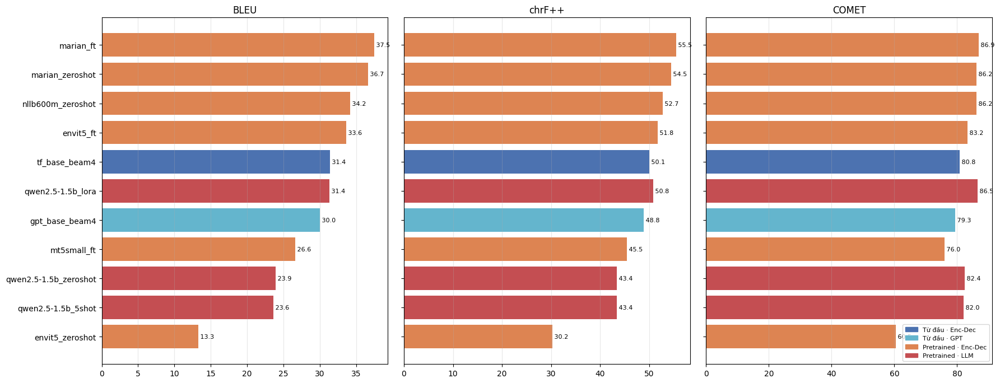

# So sánh Transformer Encoder–Decoder và Decoder-only cho dịch máy Anh → Việt

Mã nguồn thực nghiệm cho báo cáo cuối kỳ học phần **Xử lý ngôn ngữ tự nhiên**
(Ngành Khoa học máy tính, Khóa 36, Trường Đại học Sư phạm TP. Hồ Chí Minh).

- **Giảng viên:** PGS.TS. Lê Anh Cường
- **Học viên thực hiện:** Chế Chí Công · Võ Phú Vinh

Đề tài so sánh hai kiến trúc Transformer — **Encoder–Decoder** và **Decoder-only (GPT)** — theo hai cách
huấn luyện: **train từ đầu** và **dùng mô hình tiền huấn luyện** (zero-shot, few-shot, fine-tune, LoRA),
trên ngữ liệu IWSLT'15 Anh–Việt (phụ đề TED Talks). Tổng cộng **19 hệ thống** được chấm bằng cùng một quy trình
với 6 độ đo (BLEU, chrF++, TER, METEOR, BERTScore, COMET) và kiểm định paired bootstrap.

## Kết quả chính (tst2013, 1.268 câu)

| Hệ thống | Kiến trúc | Tham số | BLEU | chrF++ | TER ↓ | METEOR | BERTScore | COMET |
|---|---|---:|---:|---:|---:|---:|---:|---:|
| MarianMT + fine-tune | Enc–Dec, pretrained | 72M | **37,50** | **55,55** | **48,92** | **60,32** | **95,42** | **86,86** |
| MarianMT zero-shot | Enc–Dec, pretrained | 72M | 36,66 | 54,46 | 49,26 | 58,49 | 95,31 | 86,19 |
| NLLB-600M zero-shot | Enc–Dec, pretrained | 615M | 34,16 | 52,74 | 51,25 | 56,23 | 95,15 | 86,25 |
| envit5 + fine-tune | Enc–Dec, pretrained | 275M | 33,65 | 51,78 | 53,03 | 55,44 | 94,95 | 83,25 |
| **Transformer Enc–Dec (tự cài, từ đầu)** | Enc–Dec, từ đầu | 39,7M | 31,41 | 50,06 | 55,16 | 53,81 | 94,64 | 80,85 |
| Qwen2.5-1.5B + LoRA | Decoder-only, pretrained | 1,54B (LoRA 18,5M) | 31,35 | 50,80 | 54,68 | 55,18 | 95,02 | 86,45 |
| **GPT Decoder-only (tự cài, từ đầu)** | Decoder-only, từ đầu | 40,0M | 30,00 | 48,83 | 56,16 | 52,10 | 94,45 | 79,31 |
| mT5-small + fine-tune | Enc–Dec, pretrained | 300M | 26,65 | 45,48 | 60,11 | 48,11 | 94,12 | 75,99 |
| Qwen2.5-1.5B zero-shot | Decoder-only, pretrained | 1,54B | 23,92 | 43,43 | 61,62 | 45,59 | 94,13 | 82,43 |
| Qwen2.5-1.5B 5-shot | Decoder-only, pretrained | 1,54B | 23,62 | 43,36 | 61,91 | 45,06 | 94,15 | 81,98 |
| envit5 zero-shot | Enc–Dec, pretrained | 275M | 13,27 | 30,25 | 77,12 | 28,21 | 91,94 | 60,52 |



**Nhận xét chính**

1. Cùng ~40 triệu tham số, **Encoder–Decoder** (BLEU 31,41 · COMET 80,85) tốt hơn **Decoder-only** (30,00 · 79,31)
   có ý nghĩa thống kê, đồng thời huấn luyện và dịch nhanh hơn.
2. **MarianMT tinh chỉnh** là hệ thống tốt nhất trên mọi độ đo dù chỉ có 72 triệu tham số.
3. **Qwen2.5-1.5B** dịch zero-shot có BLEU thấp (23,92) nhưng COMET khá (82,43); **LoRA** với 1,18% tham số
   huấn luyện nâng lên 31,35 BLEU và 86,45 COMET.
4. **Pre-LN** là điều kiện để huấn luyện ổn định với cấu hình đã chọn (Post-LN chỉ đạt BLEU 6,39);
   beam search bão hoà từ beam 4.
5. Các độ đo n-gram xếp hạng gần như giống nhau nhưng bất đồng với COMET khi chấm LLM
   (Kendall τ = 0,60 giữa BLEU và COMET).

Chữ ký sacreBLEU dùng để tái lập:

```
BLEU   : nrefs:1|case:mixed|eff:no|tok:13a|smooth:exp|version:2.6.0
chrF++ : nrefs:1|case:mixed|eff:yes|nc:6|nw:2|space:no|version:2.6.0
TER    : nrefs:1|case:lc|tok:tercom|norm:no|punct:yes|asian:no|version:2.6.0
```

## Cấu trúc thư mục

```
nlp_envi/
├── envi_lib/                 # thư viện dùng chung (bản cuối cùng đã dùng để chạy)
│   ├── common.py             # đường dẫn, seed, thiết bị, AMP, chuẩn hoá văn bản, lưu bản dịch
│   ├── data.py               # tải & làm sạch IWSLT'15, chống rò rỉ, SentencePiece, batch theo số token
│   ├── models.py             # Multi-head attention, TransformerSeq2Seq, GPTDecoder, label smoothing
│   ├── decoding.py           # greedy & beam search theo batch
│   ├── train.py              # vòng lặp huấn luyện tự phục hồi (checkpoint, early stopping, NaN/OOM)
│   ├── hf_utils.py           # mô hình Hugging Face, chat template, dịch bằng LLM, LoRA
│   ├── metrics.py            # BLEU, chrF++, TER, METEOR, paired bootstrap, BLEU theo độ dài
│   ├── neural_env.py         # tạo môi trường Python riêng cho COMET/BERTScore
│   ├── eval_neural.py        # tính COMET, BERTScore
│   └── selftest.py           # 13 bài kiểm thử tự động
├── notebooks/                # 7 notebook Colab, giữ nguyên kết quả đã chạy
│   ├── NLP_00_cai_dat.ipynb
│   ├── NLP_01_du_lieu_tokenizer.ipynb
│   ├── NLP_02_transformer_encoder_decoder.ipynb
│   ├── NLP_03_gpt_decoder_only.ipynb
│   ├── NLP_04_pretrained_encoder_decoder.ipynb
│   ├── NLP_05_llm_decoder_only_lora.ipynb
│   └── NLP_06_danh_gia_tong_hop.ipynb
├── results/figures/          # hình trích từ kết quả các notebook
├── tests/run_selftest.py     # chạy bộ kiểm thử ngoài Colab
└── requirements.txt
```

| Notebook | Nội dung | GPU |
|---|---|---|
| `NLP_00_cai_dat` | Ghi thư viện `envi_lib` lên Google Drive, chạy bộ kiểm thử | Không cần |
| `NLP_01_du_lieu_tokenizer` | Tải, làm sạch, phân tích dữ liệu; huấn luyện SentencePiece BPE (16k, dùng chung Anh–Việt) | Không cần |
| `NLP_02_transformer_encoder_decoder` | Transformer Enc–Dec từ đầu + 3 biến thể ablation; beam 1/2/4/8 | L4 |
| `NLP_03_gpt_decoder_only` | GPT Decoder-only từ đầu + biến thể mã hoá vị trí hình sin; beam 1/4 | L4 |
| `NLP_04_pretrained_encoder_decoder` | MarianMT, envit5, NLLB-600M, mT5-small: zero-shot và fine-tune | A100 |
| `NLP_05_llm_decoder_only_lora` | Qwen2.5-1.5B-Instruct: zero-shot, 5-shot, LoRA | L4 |
| `NLP_06_danh_gia_tong_hop` | Chấm 6 độ đo, bootstrap, phân tích theo độ dài, beam, tương quan độ đo | L4 |

## Chạy lại thực nghiệm (Google Colab)

1. Mở Colab → **File → Open notebook → GitHub**, dán đường dẫn repo này (hoặc tải các file `.ipynb` lên Drive).
2. Chạy lần lượt `00 → 01 → 02 → 03 → 04 → 05 → 06`, mỗi notebook chọn **Runtime → Run all**.
   Notebook 02–06 cần GPU (**Runtime → Change runtime type**).
3. Mỗi notebook 01–06 nên chạy hai lượt: lượt đầu `DRY_RUN = True` (vài phút, dữ liệu và mô hình thu nhỏ,
   kết quả nằm riêng trong `dryrun/`), lượt sau `DRY_RUN = False` để chạy thật.
4. Nếu Colab ngắt kết nối, mở lại và **Run all**: huấn luyện tự tiếp tục từ checkpoint gần nhất,
   phần đã dịch xong không bị dịch lại.

Mọi dữ liệu, checkpoint, bản dịch và bảng kết quả được ghi vào `MyDrive/NLP_Final_EnVi/`:

```
MyDrive/NLP_Final_EnVi/
├── envi_lib/               # do notebook 00 ghi ra
├── data_raw/  data_clean/  # dữ liệu gốc / đã làm sạch
├── spm/                    # tokenizer SentencePiece
├── checkpoints/            # checkpoint + history.csv
├── predictions/            # bản dịch tập test của từng hệ thống
└── results/                # bảng số liệu, figures/, ket_qua_tong_hop.xlsx
```

Các thư mục này **không** đưa lên GitHub vì dung lượng lớn (xem `.gitignore`).

### Chạy bộ kiểm thử trên máy (không cần GPU)

```bash
pip install -r requirements.txt
python tests/run_selftest.py
```

## Dữ liệu

IWSLT'15 English–Vietnamese: 130.400 cặp câu train (sau làm sạch) · dev 1.500 câu · test **tst2013** (1.268 câu).

- Máy chủ Stanford NLP trả lỗi 403 khi chạy, nên dữ liệu được lấy từ bản Hugging Face
  [`IWSLT/mt_eng_vietnamese`](https://huggingface.co/datasets/IWSLT/mt_eng_vietnamese).
  Bộ này có validation trùng test (đều là tst2013), vì vậy tập dev được **tách 1.500 câu từ train** (seed cố định)
  và có bước tự kiểm tra rò rỉ dev/test.
- Văn bản được giải mã HTML (`&apos;` …), ghép lại token kiểu Moses và chuẩn hoá Unicode NFC.
- Chỉ lọc tập train (câu rỗng, trùng lặp, quá dài, lệch độ dài, câu trùng nguồn với test); dev/test giữ nguyên.

## Mô hình tiền huấn luyện đã dùng

| Mô hình | Đường dẫn |
|---|---|
| MarianMT | [Helsinki-NLP/opus-mt-en-vi](https://huggingface.co/Helsinki-NLP/opus-mt-en-vi) |
| envit5 | [VietAI/envit5-translation](https://huggingface.co/VietAI/envit5-translation) |
| NLLB-200 distilled 600M | [facebook/nllb-200-distilled-600M](https://huggingface.co/facebook/nllb-200-distilled-600M) |
| mT5-small | [google/mt5-small](https://huggingface.co/google/mt5-small) |
| Qwen2.5-1.5B-Instruct | [Qwen/Qwen2.5-1.5B-Instruct](https://huggingface.co/Qwen/Qwen2.5-1.5B-Instruct) |
| COMET | [Unbabel/wmt22-comet-da](https://huggingface.co/Unbabel/wmt22-comet-da) |

Dữ liệu và các mô hình trên thuộc về tác giả tương ứng và được dùng theo giấy phép của từng tài nguyên.

## Môi trường đã chạy

Google Colab · NVIDIA L4 22 GB (NB 02, 03, 05, 06) và A100 80 GB (NB 04) · PyTorch 2.11.0 (CUDA 13.0) ·
Transformers 5.20.1 · PEFT 0.21.2 · sacreBLEU 2.6.0 · unbabel-comet 2.2.7 · bert-score 0.3.13.
